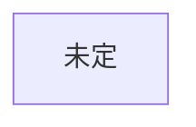

# 人物

作品ごとに分けて書く。名前 / 年齢 / 立場 / 目的 / 秘密 / 口調 / 初出

## 創元SF短編賞 用
未決: 作品未定

### 人物一覧
| 名前 | 年齢（作中時点） | 立場 | 目的 | 秘密 | 口調・一人称 | 初出 |
|---|---|---|---|---|---|---|

### 関係
| A | B | 関係 | AはBをどう呼ぶ | いつから知っているか |
|---|---|---|---|---|

### 主人公案（Claude 提案・未採用 2026-10-22。AI利用の記録として明記）
- 立ち位置: 標準化の前に生まれ、学校で外国語（英語）を学び、補正は付けていない人
- 理由: 原語を自分の耳で聞けるので、補正を通した人の会話とのずれ（誤訳）に気づける。変な訳が話者の馬鹿さとして処理される場面を、一人だけ正しく見られる
- 案: 英会話塾の元講師（塾が潰れて仕事を失った）。世界の変化が仕事や居場所の喪失として、日常の感情につながる
- 未決: 年齢／性別／現在の仕事／家族や友人

### 主人公（つば決定 2026-10-22）
- 男性。一人称は「俺」
- 補正の装置（名称未決定）が、任意から強制（全員に装着）に切り替わった年に生まれた世代
- 本人は不自由がなく、親世代にはうらやましがられるが、特に何も変わらない。世代間の分断を感じないほど、本人の生活には変化がない
- 年齢: 27歳前後（2038年生まれ・作中2065年は計算用の仮値）
- 仕事: 外国人を安く雇う側の中小企業の会社員
- 家族・友人: 親世代（補正なし）と、補正なしの友人が一人（強制化の年の生まれは補正の有無が混在するため、同い年でもありうる）
- 人柄（つば決定 2026-10-22）: 真面目。ただし、現代の発展には面白みを感じていない
- 趣味・関心: 2020年頃の少し前の歴史に強い興味がある（コロナ、AIがない、スマホが今と違う形、など）
- 見せ方の狙い（つば）: 主人公が昔のものに惹かれる姿を通して、読者に「今は近未来だ」とわかるようにする（説明せずに時代を伝える）
- 未決: 名前
- 上の Claude 案（補正なし、英会話塾の元講師）は、つばの決定により採用しない

### 彼女（つば確定 2026-10-22）
- 補正を持たない、海外の女の子。国名と言語は特定しない
- 外見・人柄: 可憐。いわゆる美人で、飾らない可愛さがある（つば）
- リアルタイム翻訳（補正）という存在を知らない。そのため、主人公の言葉が通じない（つば）
- 未決: 名前

### 先生役（つば確定 2026-10-22）
- 彼女と同じ国の出身。補正は持っていない（Claude の最初の読み取り「補正あり」は誤り。つばが訂正）
- 日本語を死ぬ気で勉強し、そのために日本にいる。会話したい一心で頑張っている
- 主人公が先生の母語を話すと、先生は原音のまま聞き取れるので、発音の良し悪しを判断できる
- 助言は日本語で伝えるしかないが、日本語のネイティブではないため、そこでも苦労する
- 未決: 名前
