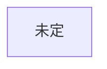

# 人物

作品ごとに分けて書く。名前 / 年齢 / 立場 / 目的 / 秘密 / 口調 / 初出

## 創元SF短編賞 用
未決: 作品未定

### 人物一覧
| 名前 | 年齢（作中時点） | 立場 | 目的 | 秘密 | 口調・一人称 | 初出 |
|---|---|---|---|---|---|---|

### 関係
| A | B | 関係 | AはBをどう呼ぶ | いつから知っているか |
|---|---|---|---|---|

### 主人公案（Claude 提案・未採用 2026-10-22。AI利用の記録として明記）
- 立ち位置: 標準化の前に生まれ、学校で外国語（英語）を学び、補正は付けていない人
- 理由: 原語を自分の耳で聞けるので、補正を通した人の会話とのずれ（誤訳）に気づける。変な訳が話者の馬鹿さとして処理される場面を、一人だけ正しく見られる
- 案: 英会話塾の元講師（塾が潰れて仕事を失った）。世界の変化が仕事や居場所の喪失として、日常の感情につながる
- 未決: 年齢／性別／現在の仕事／家族や友人

### 主人公（つば決定 2026-10-22）
- 男性
- 補正の装置（名称未決定）が、任意から強制（全員に装着）に切り替わった年に生まれた世代
- 本人は不自由がなく、親世代にはうらやましがられるが、特に何も変わらない。世代間の分断を感じないほど、本人の生活には変化がない
- 未決: 仕事／年齢／家族や友人
- 上の Claude 案（補正なし、英会話塾の元講師）は、つばの決定により採用しない
