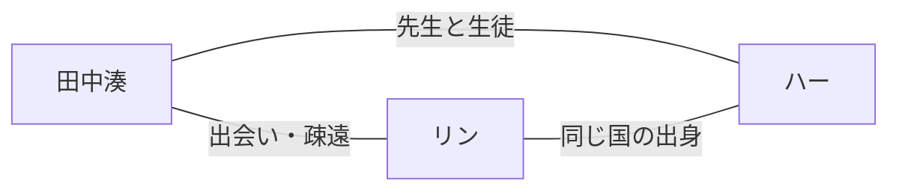

# 人物（創元用: 翻訳が消えた世界）

決定はすべて、つば決定（2026-10-22）。未決は open-items.md を見る。

## 人物一覧
| 名前 | 年齢（作中） | 立場 | 補正 | 言語・国 |
|---|---|---|---|---|
| 田中湊（たなか みなと） | 27歳 | 外国人を安く雇う側の中小企業の会社員 | あり（最初の強制世代） | 日本語・日本 |
| リン（Linh） | 未決 | 主人公が旅先で出会う、海外の女の子 | なし | ベトナム語・ベトナム |
| ハー（Hà） | 未決 | 先生役。女性。日本語を死ぬ気で勉強して、日本にいる | なし | ベトナム語・ベトナム |
| 親世代 | - | 主人公の親 | なし（旧世代） | 日本語・日本 |
| 友人 | - | 補正のない友人が一人。強制化の年の生まれは補正の有無が混在するので、同い年でもありうる | なし | 日本語・日本 |
| アルジュン | 未決 | 主人公の会社の同僚。男性 | あり | インド系 |
| 外国人の同僚（ほか） | - | 主人公の会社の同僚。現場の外国人スタッフが大集団で働く（国籍は本文で出さない） | あり | 未決 |

## 田中湊（主人公）
- 男性。一人称は「俺」。2038年生まれ
- 本人は不自由がなく、親世代にはうらやましがられるが、特に何も変わらない。世代の分断を感じるほど、本人の生活に変化がない
- 勤め先: 中小の運送会社（物流）。外国人が七割。統括する立場の中間管理職（本文で確定。2026-10-23）。人手不足で外国人の同僚が多い（つば決定 2026-10-23）
- 人柄: 真面目。ただし、現代の発展には面白みを感じていない
- 関心: 2020年頃の少し前の歴史に強い興味がある（コロナ、AIがない、スマホが今と違う形、など）
- 見せ方の狙い: 主人公が昔のものに惹かれる姿を通して、読者に「今は近未来だ」とわかるようにする（説明せずに時代を伝える）
- 板状の端末を趣味で持たせる案は、一旦なし
- 海外旅行でリンに出会い、リンの言葉は理解できるが、日本語しか話せず、通じない。リンの言語を学ぶが、時間とストレスがかかり、疎遠になる

## 社長（湊の勤め先。つば 2026-10-23）
- ステレオタイプな社長。人を酷使し、楽をしたい。AIの設定を細かくしすぎるチューニングを好む。自動運転の責任の所在の記事を題名だけ見て、「ほら見ろ！　俺の言った通りだ」と言う
- 容姿は未決（つばが、②に足す予定。湊はあだ名で呼ぶ案あり）。老いている、の意味は未確認

## 友人（歴史保存家。つば決定 2026-10-23）
- 湊の友人。補正なし。職業は歴史保存家。職名は「アーカイヴァ（歴史記録保存士）」（つば決定 2026-10-23）
- 仕事: 過去のデータをAIで検証し、デジタル化して、AIのメモリの中に出力する。それによって、バーチャル空間に新しい図書館を作る枠組みを担う
- バーチャル図書館は、ルーメンの空中投影で、歴史の場面を立体で見る形（つば決定 2026-10-23。空間に入り込む案は不採用）
- 未来の職種は、湊ではなく、この友人に持たせる（湊の職場は、想像しやすい物流にするため）。湊の「2020年頃への関心」と、友人の仕事が触れる形で使う。出番は場面3以降の案（Claude 案、未決）

## リン（彼女）
- 補正を持たない。リアルタイム翻訳（補正）という存在を知らない。そのため、主人公の言葉が通じない
- 外見・人柄: 可憐。いわゆる美人で、飾らない可愛さがある
- 端末: 今のスマホと全く同じ使い方。最新機器で、クヌートに対応している
- 国名と言語は、ベトナム語・ベトナム出身。本文で国名を出すかは、つばの書き方に合わせて、Claude が実名ルールに沿って確認する

## ハー（先生）
- 補正を持たない。リンと同じ国の出身。女性
- 日本語を死ぬ気で勉強し、そのために日本にいる。会話したい一心で頑張っている
- 主人公が先生の母語を話すと、原音のまま聞き取れるので、発音の良し悪しを判断できる。助言は日本語で伝えるしかないが、日本語のネイティブではないため、そこでも苦労する

## アルジュン（外国人の同僚。つば決定 2026-10-22）
- 男性。インド系。主人公の会社の同僚。補正（ミミ）がある。主人公は「田中さん」と呼ばれる
- 入社二年。会話は通じるが、常識は、出身国独自のまま（場面1で、友引を知らない）。そこに違和感を出し、伏線の一つにする
- 理由づけ（世界の設定）: 日本語を学ぶ人は、長く日本に住み、日本語と一緒に常識も身につける。いまは日本語の学習が消え、その部分も切れている
- 国民性のステレオタイプにせず、個人の知識の欠け方として描く（Claude の注意）

## 関係
| A | B | 関係 |
|---|---|---|
| 田中湊 | リン | 旅先で出会う。湊はリンの言葉がわかるが、湊の日本語は通じない。のちに疎遠になる |
| 田中湊 | ハー | 先生と生徒。ハーが湊の発音を見る |
| 田中湊 | アルジュン | 職場の同僚。会話は通じるが、常識にずれがある |
| リン | ハー | 同じ国の出身。関係は未決 |

