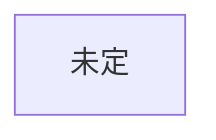

# 人物

作品ごとに分けて書く。名前 / 年齢 / 立場 / 目的 / 秘密 / 口調 / 初出

## 創元SF短編賞 用
未決: 作品未定

### 人物一覧
| 名前 | 年齢（作中時点） | 立場 | 目的 | 秘密 | 口調・一人称 | 初出 |
|---|---|---|---|---|---|---|

### 関係
| A | B | 関係 | AはBをどう呼ぶ | いつから知っているか |
|---|---|---|---|---|

