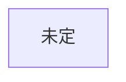

# 構成

## 創元SF短編賞 用
未決: 作品未定

### あらすじ

### ミスリードと伏線
| 読者に予想させるオチ | 本当のオチ | 伏線（どこに置くか） |
|---|---|---|

### 時系列
作中の出来事を起きた順に並べる（語る順と違ってよい）。本文の何場面目で語るかも書く。
| 作中日時 | 出来事 | 関わる人物 | 誰が知っているか | 本文の場面 |
|---|---|---|---|---|

### 樹形図

## ハヤカワSFコンテスト 用
創元の完成までは着手しない
