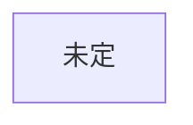

# 構成

## 創元SF短編賞 用
作品: ideas.md の3番「翻訳が消えた世界」を採用（2026-10-22 つば）。近未来の日本。下の骨組み案はネタ2向けに作ったもので、ネタ3では作り直す

### 物語の核（つば決定 2026-10-22）
- 主人公は補正のおかげで、海外で出会った女の子の言葉を理解できる。でも日本語しか話せない。彼女は補正がなく、日本語がわからないので、会話が成立せず詰む
- 主人公は彼女の言語を学ぶが、時間がかかり、ストレスにもなる。結果的に彼女とは疎遠になる
- 結末の入り口: 彼女から「結婚した」というメッセージが届く（自動翻訳される世界）。主人公は「それでよかったんだ」と受け止める
- オチ: 主人公が、学んだ言語でその国の他の人と結婚するかどうか（未決）
- 恋愛: この作品では恋愛要素を扱う（つば決定。README を更新）
- 未決: 風刺（誤訳が話者の馬鹿さとして処理される）の入れどころ／本文で描く時間の範囲

### 骨組み案（Claude 提案・つば未採用・見直し中。AI利用の記録として明記）
2026-10-22 つば指摘: 題材（翻訳）から組み立てており、日常全体の中で主人公の感情変化として翻訳要素を紛れさせるほうが深みが出る。この案は題材主導のため、採用しない可能性が高い。
約2万字、5場面（1場面約4,000字）。
1. 日常: SNSに自動翻訳が入り、海外の投稿が読めるようになる。外国に仲のいい相手がいる
2. 最初の亀裂: 主人公の何気ない投稿が訳され、見知らぬ国の人に激しく怒られる
3. 拡大: 訳の差、善意の誤訳、悪意の切り取りが喧嘩になる。主人公は原文を知る側として仲裁に入る
4. 露呈: 仲裁の最中、過去の自分の投稿にも同じ酷さがあったと気づく（刺す相手が他人から自分へ）
5. 結末: 翻訳をオフにするか続けるか。答えを説明せず行動で終わる
未決: 視点（ふつうの利用者／翻訳の仕事をしてきた人）、外国の友人の設定、SNSは架空名にする方針

### あらすじ

### ミスリードと伏線
| 読者に予想させるオチ | 本当のオチ | 伏線（どこに置くか） |
|---|---|---|

### 時系列
作中の出来事を起きた順に並べる（語る順と違ってよい）。本文の何場面目で語るかも書く。
| 作中日時 | 出来事 | 関わる人物 | 誰が知っているか | 本文の場面 |
|---|---|---|---|---|

### 樹形図

## ハヤカワSFコンテスト 用
創元の完成までは着手しない
