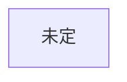

# 構成

## 創元SF短編賞 用
作品: ideas.md の3番「翻訳が消えた世界」を採用（2026-10-22 つば）。近未来の日本。下の骨組み案はネタ2向けに作ったもので、ネタ3では作り直す

### 物語の核（つば決定 2026-10-22）
- 主人公は補正のおかげで、海外で出会った女の子の言葉を理解できる。でも日本語しか話せない。彼女は補正がなく、日本語がわからないので、会話が成立せず詰む
- 主人公は彼女の言語を学ぶが、時間がかかり、ストレスにもなる。結果的に彼女とは疎遠になる
- 結末の入り口: 彼女から「結婚した」というメッセージが届く（自動翻訳される世界）。主人公は「それでよかったんだ」と受け止める
- 結末の核: 主人公は学んだ言語で彼女に「おめでとう」を送る。ただしメッセージはアプリ側で自動翻訳が入りうる（表示なし）ため、自分の言葉が届いたのか機械の訳なのか、本人にも判断がつかない（つば案、決定 2026-10-22）
- 主人公が学んだ言語でその国の他の人と結婚するかどうか: 未決（書きながら決める）
- 恋愛: この作品では恋愛要素を扱う（つば決定。README を更新）
- 未決: 風刺（誤訳が話者の馬鹿さとして処理される）の入れどころ／本文で描く時間の範囲

### 時系列（仮決定 2026-10-22。Claude 案をつばが採用。主人公は2038年生まれ。年は計算用の仮値）
| 時期 | 出来事 | 場面 | 主人公の年齢 |
|---|---|---|---|
| 2065年冬〜春先 | 職場の日常 | 1 | 27 |
| 2065年春 | 旅先で彼女と出会う | 2 | 27 |
| 2065年夏 | 連絡先を交換。アプリでやり取りするが、言葉の重みを信じきれず、学ぶと決める | 3 | 27 |
| 2065年秋〜2066年 | 文字で独学。先生と出会い、発音を見てもらう | 4 | 27〜28 |
| 2066年後半〜2067年 | 時間とストレスで連絡が減り、疎遠になる | 5 | 28〜29 |
| 2067年末〜2068年春 | 彼女から結婚の知らせ。「おめでとう」を送る | 6 | 29〜30 |
物語の期間は約2年半。

### 字数配分と執筆の目安（Claude 作成。つばが執筆の目安として使う 2026-10-22）
創元の規定: 40字×40行換算で10〜20枚（約1.6万〜3.2万字）。2.7万字を目標にし、上限3.2万字に余裕を持たせる。
| 場面 | 目標字数 | 初稿の目安日 |
|---|---|---|
| 1 職場の日常 | 3,500 | 10/29 |
| 2 旅先での出会い | 4,500 | 11/5 |
| 3 詰む | 4,500 | 11/12 |
| 4 学ぶ | 6,000 | 11/20 |
| 5 すれ違い | 4,000 | 11/25 |
| 6 知らせ | 4,500 | 11/30 |
| 合計 | 27,000 | 初稿完了 11/30 |
- 字数は tools/count.py で数える。応募時の枚数換算（空白行や改行の扱い）は、公式の要項で確認する
- 梗概（1枚以内）は、初稿が終わってから書く

### 場面表（仮決定 2026-10-22。Claude 提案をつばが「そんな感じで仮決定」と採用。変更は都度相談）
6場面、約2.7万字（創元の上限は約3.2万字）。
| # | 場面 | 内容 |
|---|---|---|
| 1 | 職場の日常 | 27歳。外国人の同僚と何の苦もなく働く。国の傾きは背景にあるだけで、本人は何も変わらないと感じている |
| 2 | 旅先での出会い | 彼女の言葉は主人公の耳に日本語で届く。主人公の日本語は彼女にはまったく通じない |
| 3 | 詰む | 通じない。連絡先を交換し、アプリで文字を送るが、翻訳された言葉にどれだけ気持ちが乗るのか信じきれない。彼女の言語を学ぶと決める |
| 4 | 学ぶ | 教材がほとんどなく、補正のせいで耳で学べず、文字だけで学ぶ。彼女と同じ国出身で、日本語を死ぬ気で勉強して日本にいる、補正のない人と出会う（つば決定）。先生は主人公の発音を聞いて可否を判断し、日本語で助言するが、日本語がネイティブでなく伝えるのに苦労する。1回目の誤訳場面（誰かが馬鹿にされる） |
| 5 | すれ違い | 時間とストレスで連絡が減る。2回目の誤訳場面。疎遠になる |
| 6 | 知らせ | 彼女から「結婚した」というメッセージ。「それでよかったんだ」。学んだ言葉で「おめでとう」を送る。届いたのが自分の言葉か機械の訳か判断がつかない |
- 期間: 出会いから結婚の知らせまで、2〜3年（つば決定 2026-10-22。言語を学ぶのはひと苦労だから）
- 未決: 場面3の「信じきれない」を「誤訳の責任は発言者が負う世界」と結びつけるか（Claude 案）

### 旧骨組み案（ネタ2向け。廃案。Claude 提案・AI利用の記録として残す）
2026-10-22 つば指摘: 題材（翻訳）から組み立てており、日常全体の中で主人公の感情変化として翻訳要素を紛れさせるほうが深みが出る。この案は題材主導のため、採用しない可能性が高い。
約2万字、5場面（1場面約4,000字）。
1. 日常: SNSに自動翻訳が入り、海外の投稿が読めるようになる。外国に仲のいい相手がいる
2. 最初の亀裂: 主人公の何気ない投稿が訳され、見知らぬ国の人に激しく怒られる
3. 拡大: 訳の差、善意の誤訳、悪意の切り取りが喧嘩になる。主人公は原文を知る側として仲裁に入る
4. 露呈: 仲裁の最中、過去の自分の投稿にも同じ酷さがあったと気づく（刺す相手が他人から自分へ）
5. 結末: 翻訳をオフにするか続けるか。答えを説明せず行動で終わる
未決: 視点（ふつうの利用者／翻訳の仕事をしてきた人）、外国の友人の設定、SNSは架空名にする方針

### あらすじ

### ミスリードと伏線
| 読者に予想させるオチ | 本当のオチ | 伏線（どこに置くか） |
|---|---|---|

### 時系列
作中の出来事を起きた順に並べる（語る順と違ってよい）。本文の何場面目で語るかも書く。
| 作中日時 | 出来事 | 関わる人物 | 誰が知っているか | 本文の場面 |
|---|---|---|---|---|

### 樹形図

## ハヤカワSFコンテスト 用
創元の完成までは着手しない
