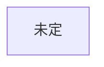

# 構成

## 創元SF短編賞 用
未決: 作品未定（候補: ideas.md の2番 自動翻訳もの。2026-10-22 時点で未採用）

### 骨組み案（Claude 提案・つば未採用・見直し中。AI利用の記録として明記）
2026-10-22 つば指摘: 題材（翻訳）から組み立てており、日常全体の中で主人公の感情変化として翻訳要素を紛れさせるほうが深みが出る。この案は題材主導のため、採用しない可能性が高い。
約2万字、5場面（1場面約4,000字）。
1. 日常: SNSに自動翻訳が入り、海外の投稿が読めるようになる。外国に仲のいい相手がいる
2. 最初の亀裂: 主人公の何気ない投稿が訳され、見知らぬ国の人に激しく怒られる
3. 拡大: 訳の差、善意の誤訳、悪意の切り取りが喧嘩になる。主人公は原文を知る側として仲裁に入る
4. 露呈: 仲裁の最中、過去の自分の投稿にも同じ酷さがあったと気づく（刺す相手が他人から自分へ）
5. 結末: 翻訳をオフにするか続けるか。答えを説明せず行動で終わる
未決: 視点（ふつうの利用者／翻訳の仕事をしてきた人）、外国の友人の設定、SNSは架空名にする方針

### あらすじ

### ミスリードと伏線
| 読者に予想させるオチ | 本当のオチ | 伏線（どこに置くか） |
|---|---|---|

### 時系列
作中の出来事を起きた順に並べる（語る順と違ってよい）。本文の何場面目で語るかも書く。
| 作中日時 | 出来事 | 関わる人物 | 誰が知っているか | 本文の場面 |
|---|---|---|---|---|

### 樹形図

## ハヤカワSFコンテスト 用
創元の完成までは着手しない
